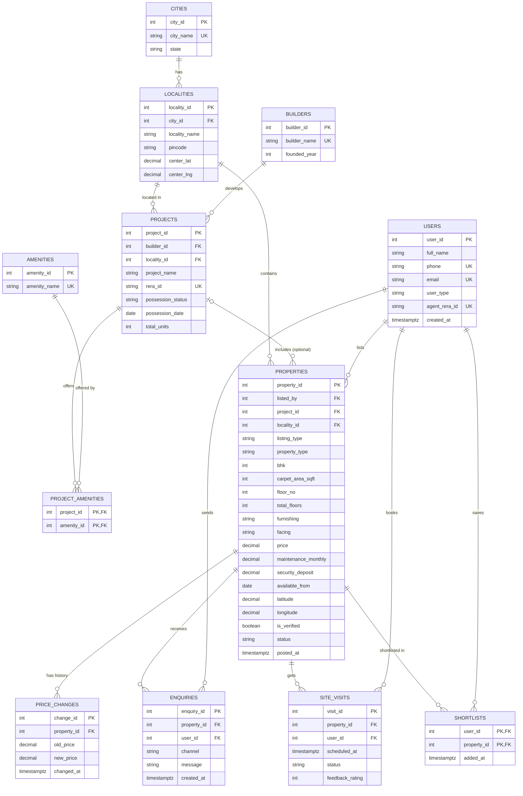

# Phase 2: Schema Design

Schema `housing` · 12 tables · 12 PK · 15 FK · 8 UNIQUE · 45 CHECK · tested on PostgreSQL 16.15 (requires 15+).
Files: `sql/01_schema.sql` (DDL), `sql/02_load_data.sql` (load + verification), `diagrams/er_diagram.png`.

How to run (from the project root, after unzipping `seed_data.zip`; the CSVs are not committed):
```bash
psql -d <db> -f sql/01_schema.sql
psql -d <db> -f sql/02_load_data.sql
```

## 1. Type decisions
| Need | Type | Why |
|------|------|-----|
| Money (price, rent, deposit, maintenance) | `NUMERIC(12,2)` / `NUMERIC(10,2)` | Exact decimals; floats give rounding errors. Max seed price is 99,470,000.00. |
| Timestamps | `TIMESTAMPTZ` | The CSVs carry a `+05:30` offset; PostgreSQL stores UTC and converts per session. |
| Dates without time | `DATE` | `possession_date`, `available_from`. |
| Yes/no | `BOOLEAN` | `is_verified` (CSV uses `t`/`f`). |
| Small whole numbers | `SMALLINT` | BHK, floors, rating, founded year. |
| Fixed-length codes | `CHAR(6)` pincode, `CHAR(10)` phone | Always the same length; text, not number (no arithmetic, leading zeros safe). |
| Coordinates | `NUMERIC(9,6)` | 6 decimals is about 0.1 m, and values are exact. |
| Status / type values | `VARCHAR` + `CHECK ... IN (...)` | Visible in the DDL and easy to extend (swap a CHECK instead of `ALTER TYPE`). |
| IDs | `INTEGER`, no sequence | Max 2.4 M rows at 20×, and W01/W03 insert explicit ids (90,000,001). Ids come from the export. |

## 2. Data dictionary

### cities (10 rows)
| Column | Type | Constraints | Why |
|--------|------|-------------|-----|
| city_id | INTEGER | PK | Surrogate key from the export |
| city_name | VARCHAR(50) | NOT NULL, UNIQUE, not blank | Natural key; no two cities share a name |
| state | VARCHAR(50) | NOT NULL, not blank | Every city belongs to a state |

### localities (100 rows)
| Column | Type | Constraints | Why |
|--------|------|-------------|-----|
| locality_id | INTEGER | PK | |
| city_id | INTEGER | NOT NULL, FK → cities, ON DELETE RESTRICT | A locality cannot exist without its city |
| locality_name | VARCHAR(100) | NOT NULL; UNIQUE (city_id, locality_name) | Same name allowed in different cities, never twice in one |
| pincode | CHAR(6) | NOT NULL, CHECK `^[1-9][0-9]{5}$` | Indian PIN: 6 digits, no leading 0. Not UNIQUE: several localities can share a PIN (in the seed all 100 differ) |
| center_lat / center_lng | NUMERIC(9,6) | NOT NULL, CHECK 6–38 / 68–98 | Must lie inside India's bounding box |

### builders (150 rows)
| Column | Type | Constraints | Why |
|--------|------|-------------|-----|
| builder_id | INTEGER | PK | |
| builder_name | VARCHAR(100) | NOT NULL, UNIQUE | One row per developer |
| founded_year | SMALLINT | NOT NULL, CHECK 1850–2026 | Sanity range (seed: 1960–2019) |

### projects (1,200 rows)
| Column | Type | Constraints | Why |
|--------|------|-------------|-----|
| project_id | INTEGER | PK | |
| builder_id | INTEGER | NOT NULL, FK → builders, RESTRICT | Every project has a builder |
| locality_id | INTEGER | NOT NULL, FK → localities, RESTRICT | Every project is in a locality |
| project_name | VARCHAR(150) | NOT NULL, not blank | |
| rera_id | VARCHAR(20) | **NULL allowed**, UNIQUE, CHECK `^[A-Z]{2}-RERA-PR-[0-9]{8}$` | 171 projects are not registered yet. A UNIQUE column accepts many NULLs in PostgreSQL (NULL ≠ NULL), so the 1,029 real ids stay unique |
| possession_status | VARCHAR(20) | NOT NULL, CHECK IN (`READY_TO_MOVE`, `UNDER_CONSTRUCTION`) | |
| possession_date | DATE | NOT NULL | Actual date (ready) or promised date (under construction); never empty in the seed |
| total_units | INTEGER | NOT NULL, CHECK > 0 | Seed range 100–999 |

### amenities (15 rows)
| Column | Type | Constraints | Why |
|--------|------|-------------|-----|
| amenity_id | INTEGER | PK | |
| amenity_name | VARCHAR(50) | NOT NULL, UNIQUE | |

### project_amenities (6,806 rows)
| Column | Type | Constraints | Why |
|--------|------|-------------|-----|
| project_id | INTEGER | PK part 1, FK → projects, **CASCADE** | |
| amenity_id | INTEGER | PK part 2, FK → amenities, **CASCADE** | |

Composite PK `(project_id, amenity_id)`: a project offers an amenity or it does not, so a duplicate pair is meaningless. There is no surrogate key because nothing references this table. A link row has no meaning without either parent, hence CASCADE.

### users (40,000 rows)
| Column | Type | Constraints | Why |
|--------|------|-------------|-----|
| user_id | INTEGER | PK | |
| full_name | VARCHAR(100) | NOT NULL, not blank | |
| phone | CHAR(10) | NOT NULL, UNIQUE, CHECK `^[6-9][0-9]{9}$` | Sign-in key (R23); Indian mobiles start with 6–9 |
| email | VARCHAR(150) | **NULL allowed**, UNIQUE, CHECK has `@` and a dot | 15,990 users gave no email; unique when present |
| user_type | VARCHAR(10) | NOT NULL, CHECK IN (`SEEKER`, `OWNER`, `AGENT`) | One table, three roles |
| agent_rera_id | VARCHAR(20) | **NULL allowed**, UNIQUE, CHECK `^AG-RERA-[0-9]{8}$` | Only agents are RERA-registered |
| created_at | TIMESTAMPTZ | NOT NULL | |

Table-level CHECK: `(user_type = 'AGENT') = (agent_rera_id IS NOT NULL)`. Every agent has an id and nobody else has one.

### properties (120,060 rows)
| Column | Type | Constraints | Why |
|--------|------|-------------|-----|
| property_id | INTEGER | PK | |
| listed_by | INTEGER | NOT NULL, FK → users, **RESTRICT** | Listing history must not vanish with a user; deactivate the user instead |
| project_id | INTEGER | **NULL allowed**, FK → projects, **SET NULL** | Houses, plots and many flats are stand-alone. If a project row is removed, the listing survives as stand-alone (it keeps its own `locality_id`) |
| locality_id | INTEGER | NOT NULL, FK → localities, RESTRICT | Every property has a location, also stand-alone ones |
| listing_type | VARCHAR(4) | NOT NULL, CHECK IN (`RENT`, `SALE`) | |
| property_type | VARCHAR(20) | NOT NULL, CHECK IN (`APARTMENT`, `INDEPENDENT_HOUSE`, `VILLA`, `PLOT`) | |
| bhk | SMALLINT | NULL ⇔ PLOT, CHECK 1–10 | Plots have no rooms |
| carpet_area_sqft | INTEGER | NOT NULL, CHECK > 0 | Seed 730–4,199 |
| floor_no | SMALLINT | NOT NULL ⇔ APARTMENT, CHECK ≥ 0 and ≤ total_floors | Only a flat sits on one floor; 0 = ground floor |
| total_floors | SMALLINT | NULL ⇔ PLOT, CHECK ≥ 1 | Houses and villas have 1–3, apartments 4–33 |
| furnishing | VARCHAR(20) | NULL ⇔ PLOT, CHECK IN (`UNFURNISHED`, `SEMI_FURNISHED`, `FULLY_FURNISHED`) | A plot cannot be furnished |
| facing | VARCHAR(12) | NOT NULL, CHECK IN 8 compass directions | Present for every row, plots too |
| price | NUMERIC(12,2) | NOT NULL, CHECK > 0 | Rent per month (RENT) or total price (SALE) |
| maintenance_monthly | NUMERIC(10,2) | NULL allowed, CHECK ≥ 0 | In the seed it is empty exactly when `project_id` is empty (society maintenance) |
| security_deposit | NUMERIC(12,2) | NULL allowed, CHECK ≥ 0, only if RENT | A deposit applies to rentals only |
| available_from | DATE | NOT NULL | |
| latitude / longitude | NUMERIC(9,6) | NOT NULL, India bounding box | R05 map search relies on them |
| is_verified | BOOLEAN | NOT NULL, DEFAULT FALSE | The default is needed because W01 omits the column |
| status | VARCHAR(10) | NOT NULL, CHECK IN (`ACTIVE`, `INACTIVE`, `RENTED`, `SOLD`) | |
| posted_at | TIMESTAMPTZ | NOT NULL | |

Business-rule CHECKs on `properties`:
- `ck_prop_plot_vs_bhk`, `ck_prop_plot_vs_furnishing`, `ck_prop_plot_vs_total_floors`: a plot has no BHK, furnishing or floors, and everything else has all three.
- `ck_prop_floor_only_apartment`: only apartments have `floor_no`. `ck_prop_floor_le_total`: a floor cannot be above the building.
- `ck_prop_project_type`: only apartments and villas can belong to a project.
- `ck_prop_deposit_only_rent`: a deposit exists only for rentals.
- `ck_prop_status_vs_listing`: RENTED only for rentals and SOLD only for sales.

### price_changes (23,425 rows)
| Column | Type | Constraints | Why |
|--------|------|-------------|-----|
| change_id | INTEGER | PK | |
| property_id | INTEGER | NOT NULL, FK → properties, **CASCADE** | History belongs to the listing |
| old_price / new_price | NUMERIC(12,2) | NOT NULL, CHECK > 0, and `new_price <> old_price` | A change must change something. Increases are allowed even though the seed has only drops |
| changed_at | TIMESTAMPTZ | NOT NULL | |

### enquiries (100,000 rows)
| Column | Type | Constraints | Why |
|--------|------|-------------|-----|
| enquiry_id | INTEGER | PK | |
| property_id | INTEGER | NOT NULL, FK → properties, **CASCADE** | An enquiry about a removed listing is meaningless |
| user_id | INTEGER | NOT NULL, FK → users, **CASCADE** | Removing a user removes their personal activity |
| channel | VARCHAR(10) | NOT NULL, CHECK IN (`CALL`, `WHATSAPP`, `FORM`) | |
| message | VARCHAR(500) | NULL allowed | Optional free text (50,057 empty) |
| created_at | TIMESTAMPTZ | NOT NULL | |

`(property_id, user_id)` is deliberately **not** UNIQUE: a seeker may enquire again later. The seed has no repeats, but the business rule does not forbid them.

### site_visits (35,120 rows)
| Column | Type | Constraints | Why |
|--------|------|-------------|-----|
| visit_id | INTEGER | PK | |
| property_id | INTEGER | NOT NULL, FK → properties, CASCADE | |
| user_id | INTEGER | NOT NULL, FK → users, CASCADE | |
| scheduled_at | TIMESTAMPTZ | NOT NULL | |
| status | VARCHAR(10) | NOT NULL, CHECK IN (`SCHEDULED`, `COMPLETED`, `CANCELLED`, `NO_SHOW`) | |
| feedback_rating | SMALLINT | NULL allowed, CHECK 1–5, and only if status = `COMPLETED` | A rating exists only after a completed visit |

`(property_id, user_id)` is not UNIQUE either (a seeker can visit the same flat twice), and W03 must be able to insert a new visit for an existing pair.

### shortlists (69,999 rows)
| Column | Type | Constraints | Why |
|--------|------|-------------|-----|
| user_id | INTEGER | PK part 1, FK → users, CASCADE | |
| property_id | INTEGER | PK part 2, FK → properties, CASCADE | |
| added_at | TIMESTAMPTZ | NOT NULL | |

Composite PK `(user_id, property_id)`: a seeker shortlists a property at most once. The seed has 69,999 distinct pairs.

## 3. ON DELETE rules (15 foreign keys)
| Foreign key | Rule | Reason |
|-------------|------|--------|
| localities.city_id → cities | RESTRICT | Reference data; never delete a city that still has localities |
| projects.builder_id → builders | RESTRICT | A builder with projects must not disappear silently |
| projects.locality_id → localities | RESTRICT | Same |
| properties.listed_by → users | RESTRICT | Keep listing history; deactivate the user instead |
| properties.locality_id → localities | RESTRICT | Same as above |
| properties.project_id → projects | SET NULL | The project link is optional by design; the listing survives as stand-alone |
| project_amenities.project_id / amenity_id | CASCADE | Pure link rows with no meaning alone |
| price_changes.property_id → properties | CASCADE | Dependent history |
| enquiries / site_visits / shortlists → properties | CASCADE | Activity on a removed listing is meaningless |
| enquiries / site_visits / shortlists → users | CASCADE | Personal data goes with the user (right to erasure) |

## 4. When and why columns are empty (NULL analysis, seed data)
| Column | NULL rows | When / why |
|--------|----------:|------------|
| properties.project_id | 54,009 | All 13,434 independent houses, all 3,616 plots and 36,959 stand-alone apartments. Villas (5,315) are always in a project |
| properties.bhk | 3,616 | Plots only |
| properties.floor_no | 22,365 | Every non-apartment (houses, villas, plots) |
| properties.total_floors | 3,616 | Plots only |
| properties.furnishing | 3,616 | Plots only |
| properties.maintenance_monthly | 54,009 | Exactly the rows with no project. Observed pattern, not enforced, because a stand-alone flat in an unregistered society could legitimately pay maintenance |
| properties.security_deposit | 54,060 | Every SALE row (deposit applies to rentals; all 66,000 rentals have one) |
| projects.rera_id | 171 | Project not registered with RERA |
| users.email | 15,990 | Optional at sign-up |
| users.agent_rera_id | 37,951 | Every non-agent (owners and seekers) |
| enquiries.message | 50,057 | Calls and quick forms often carry no text |
| site_visits.feedback_rating | 20,426 | 13,999 visits that were never completed (scheduled, cancelled, no-show) plus 6,427 completed visits where the seeker skipped the rating |

## 5. Relationships and cardinalities
| Relationship | Cardinality |
|--------------|-------------|
| cities – localities | 1 : N |
| localities – projects | 1 : N |
| builders – projects | 1 : N |
| projects – amenities | **M : N**, resolved by `project_amenities` |
| localities – properties | 1 : N |
| projects – properties | 1 : N (optional on the property side: 0..1) |
| users – properties (`listed_by`) | 1 : N |
| properties – price_changes | 1 : N |
| users – properties via `enquiries` | **M : N** with attributes (channel, message, time) |
| users – properties via `site_visits` | **M : N** with attributes (time, status, rating) |
| users – properties via `shortlists` | **M : N**, resolved by the composite PK |

There are no 1 : 1 relationships between tables.

## 6. ER diagram
Image: `diagrams/er_diagram.png`. Mermaid source:



## 7. Functional dependencies and normal form
| Table | Functional dependencies | Normal form |
|-------|-------------------------|-------------|
| cities | city_id → city_name, state; city_name → city_id (candidate key) | BCNF |
| localities | locality_id → all; (city_id, locality_name) → locality_id (candidate key). `pincode` does not determine anything: one PIN can cover several localities | BCNF |
| builders | builder_id → all; builder_name → builder_id | BCNF |
| projects | project_id → all; rera_id → project_id (candidate key) | BCNF |
| amenities | amenity_id → amenity_name; amenity_name → amenity_id | BCNF |
| project_amenities | (project_id, amenity_id) is the whole key, no non-key column | BCNF |
| users | user_id → all; phone → user_id; email → user_id; agent_rera_id → user_id (all candidate keys). `user_type` decides whether `agent_rera_id` exists, not its value | BCNF |
| properties | property_id → all. One extra dependency: **project_id → locality_id** (when a project is set); see section 8 | 2NF; the transitive dependency project_id → locality_id breaks strict 3NF for project rows, accepted and justified below |
| price_changes | change_id → all | BCNF |
| enquiries | enquiry_id → all | BCNF |
| site_visits | visit_id → all | BCNF |
| shortlists | (user_id, property_id) → added_at | BCNF |

Repeating groups are avoided (BHK, floors and amenities are not packed into one column). Amenities are a separate M : N table, so the model is in 1NF and 2NF everywhere.

## 8. Derived or redundant columns
| Column | Redundant with | Kept? | Justification |
|--------|----------------|-------|---------------|
| Price per sq ft | `price / carpet_area_sqft` | **Not stored** | Computed in R02, R04 and R15. A stored copy could go stale. Only worth materializing if Phase 4 proves it necessary |
| `properties.price` | Newest `price_changes.new_price` | **Kept** | IC2: 23,425 of 23,425 properties with a change match exactly. Every search reads the current price, and deriving it from the history table would add a join to every search. Cost: W02 updates `price` but does not write a `price_changes` row, so production needs a trigger or app logic to keep the two in sync |
| `properties.locality_id` | `projects.locality_id` (via `project_id`) | **Kept** | IC1: 0 mismatches. 54,009 properties have no project, so the column is needed for them, and searches filter on it without a join. It could be enforced with a composite FK `(project_id, locality_id)` → `projects` (needs `UNIQUE (project_id, locality_id)` on projects); not done, to keep the baseline schema simple |
| `price_changes.old_price` | Previous row's `new_price` (or the original price) | **Kept** | An audit snapshot. R08 needs both prices without a self-join. In the seed each property has at most one change |

## 9. Indexes that exist (all automatic, none created by hand)
20 indexes, from PK and UNIQUE constraints only:
- cities: `cities_pkey`, `uq_cities_name`
- localities: `localities_pkey`, `uq_localities_city_name`
- builders: `builders_pkey`, `uq_builders_name`
- projects: `projects_pkey`, `uq_projects_rera` (this serves R10)
- amenities: `amenities_pkey`, `uq_amenities_name`
- project_amenities: `pk_project_amenities`
- users: `users_pkey`, `uq_users_phone` (serves R23), `uq_users_email`, `uq_users_agent_rera`
- properties: `properties_pkey`
- price_changes: `price_changes_pkey`; enquiries: `enquiries_pkey`; site_visits: `site_visits_pkey`; shortlists: `pk_shortlists`

PostgreSQL does **not** index foreign-key columns automatically, so `properties.listed_by`, `properties.locality_id`, `properties.project_id`, `enquiries.property_id` and similar columns have no index yet. That is for Phase 4.

## 10. Load and verification results
All 12 files loaded in one transaction with no error. Row counts:

| Table | Loaded | Expected | Result |
|-------|-------:|---------:|:------:|
| cities | 10 | 10 | OK |
| localities | 100 | 100 | OK |
| builders | 150 | 150 | OK |
| projects | 1,200 | 1,200 | OK |
| amenities | 15 | 15 | OK |
| project_amenities | 6,806 | 6,806 | OK |
| users | 40,000 | 40,000 | OK |
| properties | 120,060 | 120,060 | OK |
| price_changes | 23,425 | 23,425 | OK |
| enquiries | 100,000 | 100,000 | OK |
| site_visits | 35,120 | 35,120 | OK |
| shortlists | 69,999 | 69,999 | OK |

Integrity checks (queries are in `sql/02_load_data.sql`, section VERIFICATION 2):

| Check | Violations |
|-------|-----------:|
| IC1 A property inside a project is in the project's locality | 0 |
| IC2 `properties.price` equals the newest `price_changes.new_price` | 0 |
| IC3 Only OWNER or AGENT users list properties | 0 |
| IC4 Only SEEKER users enquire, book visits or shortlist | 0 |
| IC5 A price change never predates the listing | 0 |
| IC6 An enquiry never predates the listing | 0 |
| IC7 Every `old_price` ≥ the current price (all recorded changes are drops) | 0 |
| IC8 Data quality: lister account created **after** the listing was posted | **2,963** |
| IC9 Data quality: `posted_at` after 30 Jun 2026 | **1** |

IC3 and IC4 cannot be enforced by a plain CHECK because they depend on another table. They would need a trigger, so they are verified here instead.

## 11. Data problems found
1. **R13 returns a wrong (empty) result.** 54,009 properties have `project_id = NULL`, so `NOT IN` yields no rows. `NOT EXISTS` shows 120 projects with no listing.
2. **2,963 properties were posted before their lister's account existed** (`users.created_at` is later than `posted_at`). Likely synthetic data. No constraint is possible, and no rows were changed.
3. **Dates after the 30 Jun 2026 snapshot:** 1 property (latest `posted_at` is 6 Jul 2026), 628 price changes (up to 2 Aug 2026) and 3,746 shortlists (up to 11 Aug 2026). Because of this there are no upper-bound date CHECKs. Site visits after that date (2,820) are legitimate future bookings.
4. **One property has `available_from` earlier than its posting date**, so no CHECK ties these two columns.
5. **6,427 completed visits (about 30%) have no rating.** A rating is therefore optional even after a completed visit. The CHECK only enforces "a rating implies COMPLETED". Seed ratings run 2–5, but the allowed range is 1–5.
6. **60 groups of duplicate active flats** (same lister, locality, area, floor and BHK), which is what R18 looks for. A UNIQUE constraint on those columns would reject the seed data, so none was added.
7. **180 of 400 under-construction projects** have a promised possession date before 1 Jul 2026 (the delayed projects R24 reports). This is business data, not a schema issue.
8. **Time zone:** the CSVs use +05:30. R04 and R20 truncate timestamps to day or month, so the session time zone must be `Asia/Kolkata` to get the intended results.